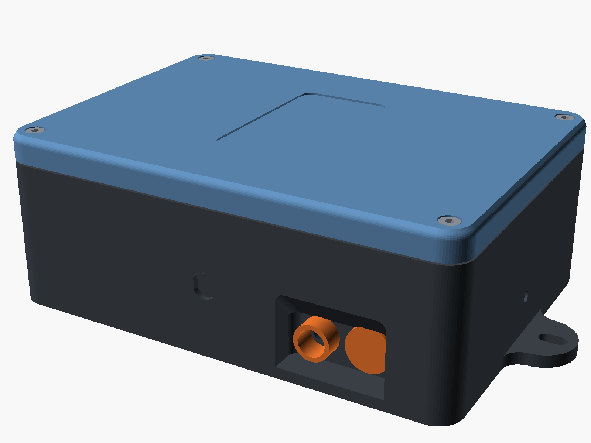

# thesada-hw

Hardware for the [thesada](https://github.com/Thesada) property monitoring
platform. Boards are designed in EasyEDA Pro, the case in OpenSCAD.

| Folder | What it is |
|---|---|
| [`base-carrier-v0.2/`](base-carrier-v0.2/) | the carrier board: project source (`.epro`), schematic and board PDFs, a 4-layer Gerber and drill set ready to order, the BOM with LCSC part numbers, the pick-and-place file, the netlist and a STEP 3D model (zipped) for enclosure work |
| [`enclosure/node/`](enclosure/node/) | the thesada node case: a printed, gasket-sealed wall case for the carrier plus a LILYGO T-SIM7080G-S3, with a shorter variant for a Freenove FNK0085. Parametric source, STLs in print orientation and preview renders |

## base carrier v0.2

A shield that carries the sensor front end and plugs onto an off-the-shelf
ESP32 board, which supplies the MCU, WiFi and, on the LILYGO, the cellular
modem. This is the board that is built and running; the firmware is
[thesada-fw](https://github.com/Thesada/thesada-fw).

| | |
|---|---|
| CT current channels | 2, differential, one per pump |
| CT connectors | 3.5 mm jack or 3-pin JST, per channel |
| ADC | 1x ADS1115 |
| 1-Wire | 4 connectors on a single bus, plus a DS18B20 on the board itself |
| Base boards | header sets for LILYGO T-SIM7080-S3 and Freenove ESP32 |
| Protection | TVS on every analog net and on the 1-Wire line, TVS and a resettable fuse on the power input |

v0.1 came back from the fab, was assembled and tested, and dropped one part
that did not belong (D2). v0.2 is that fix and the revision to build.

## thesada node case

PETG body and lid, a printed TPU gasket, TPU boots for the two 3.5 mm jacks, PG7
knockouts for the 1-Wire probes, a DC barrel jack knockout and an SMA knockout for
an external LTE antenna. Lid screws go into heat-set inserts outside the seal
line. The case suits any node use, a freeze alarm is one example. The [case README](enclosure/node/README.md) lists every dimension,
where it comes from, what is still to measure and how to print it.

## Checks

`make` lists the targets. `make setup && make test` runs every check, OpenSCAD in
the pinned image (`OPENSCAD_IMAGE` in the [Makefile](Makefile)), so only docker,
make, bash, git and python3 are needed.

| Target | Checks |
|---|---|
| `render` | both case variants render, every `assert` holds |
| `overhang` | `check_overhang.py` on every fresh render |
| `fresh` | each committed STL is the geometry a fresh render gives (bounding box, volume, area, vertices within 0.001 mm, OpenSCAD output is not byte-stable) |
| `dco` | every commit since `BASE` is authored as and signed off by the `DCO_EMAIL` address |
| `sanitize` | no private IPs, internal host names, local paths, secret shapes or unexpected commit trailers in the lines and commit messages since `BASE` |
| `selftest` | each check above fails on a seeded bad input |

`make build` re-exports every STL and PNG. Commit them with the source change,
`fresh` fails otherwise.

## Licence

[CERN-OHL-P-2.0](https://cern.ch/cern-ohl). SPDX-License-Identifier: CERN-OHL-P-2.0
