<!--
SPDX-License-Identifier: CERN-OHL-P-2.0
-->

# thesada node case

A printed, gasket-sealed wall case for a thesada node: the [base carrier](../../base-carrier-v0.2/)
at the bottom and a LILYGO T-SIM7080G-S3 on top of it on long stacking pins, the
18650 cell under the LILYGO in the gap. PETG body and lid, a printed TPU gasket, a
recessed port panel with TPU boots for the two 3.5 mm jacks, four PG7 knockouts for the 1-Wire probes
on the wall next to J3A-D, a knockout for a panel-mount DC barrel jack on the port wall, an SMA knockout for an external LTE antenna. Lid screws come from the top into heat-set inserts
in the body corners. Board, lid, seal and jack boot are fitted.
A shorter variant takes a Freenove FNK0085 instead of the LILYGO, see [Freenove variant](#freenove-variant).

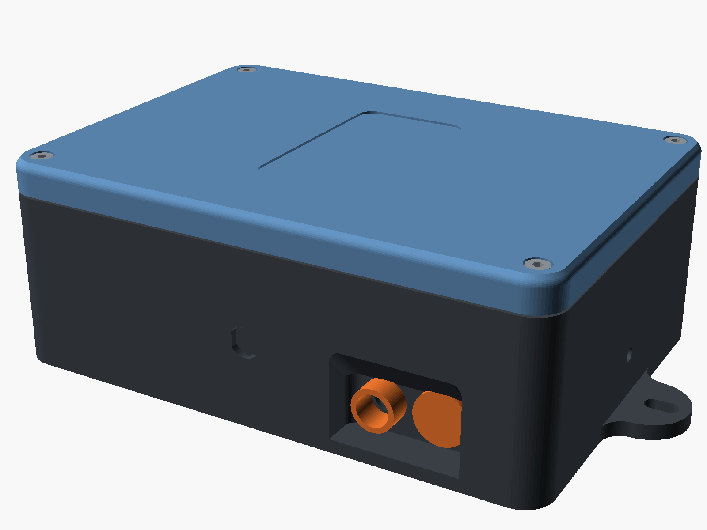
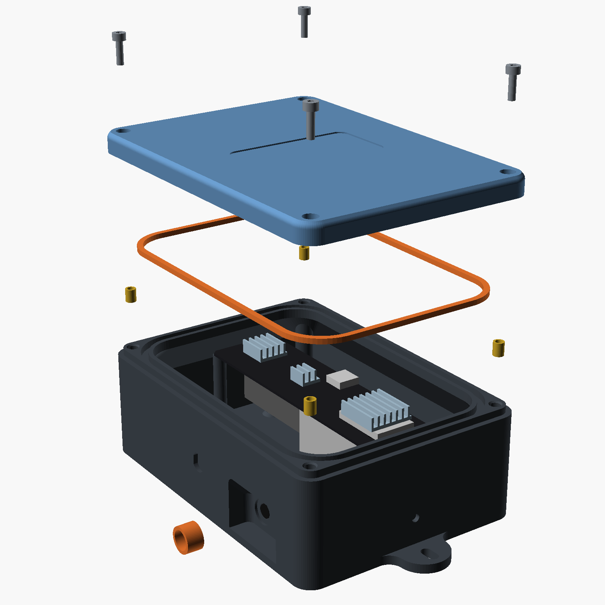
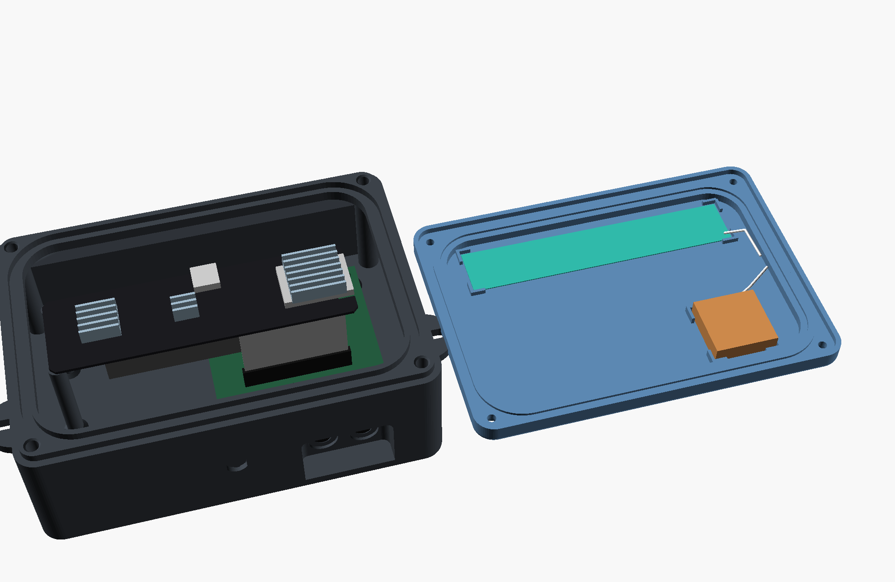

| | |
|---|---|
| Outside | 104 x 146 x 55 mm (body 49, lid 6), plus two 16 mm wall ears |
| Seal | TPU ring 2.0 x 2.4 mm in a 3.2 x 3.0 groove, squeezed 25 % to 1.8 by a lid tongue |
| Lid screws | 4x M3 x 12 DIN 912 from the top into 8 mm long M3 heat-set inserts (`m3_small`) in the body corners, outside the seal line. Buy M3 x 12: insert 8 + lid clamp 2.8 = 10.8 minimum. A 10 mm lid insert needs M3 x 16, a 4 or 6 mm insert takes M3 x 12 too. Insert holes are 4.15 mm (PLA, `m3_small`) with a 0.6 mm 45 deg lead-in chamfer |
| Insert test | `insert_test`: holes 4.0, 4.2 and 4.4 side by side, labelled. `insert_test_fine` has 4.3, 4.35 and 4.4 and `insert_test_fine_small` has 4.1, 4.15 and 4.2. `ins_d` is 4.35 for `m3_large` in PLA and PETG, 4.15 for `m3_small`. ABS reuses those values as placeholders, check: coupon |
| Heatsinks | 12.4 mm free above the LILYGO top under the lid. Keep-out for 6 mm stick-on heatsinks on the ESP32-S3 module (20 x 20), SIM7080G (14 x 14) and PMU (9 x 9) |
| Board mount | carrier on four 5 mm standoffs (4 mm long M3 heat-set inserts, `m3_small`, 4.15 mm hole in PLA with a 0.6 mm chamfer, pocket 6 deep), LILYGO modem end on two 36.6 mm standoffs (M2 self-tapping), header end held by the 32 pins |
| Source | [`node-case.scad`](node-case.scad), all sizes are parameters at the top |

The screw heads sit in 3.2 mm counterbores in the lid corners, so the case opens
on the wall. The LILYGO buttons, switch and SD card sit right under the lid.

## Where the numbers come from

| Fact | Value | Source |
|---|---|---|
| Carrier outline | 76.2 x 63.5 mm | `base-carrier-v0.2/Gerber_base-carrier-v0.2.zip`, `Gerber_BoardOutlineLayer.GKO` |
| Carrier mounting holes | 4x 3.2 mm at 4.064 mm from each edge | `Drill_NPTH_Through.DRL`, tool T02 |
| Carrier thickness, part heights | 1.59 mm, XH 7.0 mm, female header 8.5 mm | carrier STEP model |
| Carrier header rows | U1_A2 x 29.46, U1_A1 x 59.94, pins y 12.95 to 51.05 | `PickAndPlace.csv` |
| 3.5 mm jacks J1A, J2A | y 29.46 and 14.48 on the x = 0 edge, barrel face x -2.9, centre 2.5 above the board | pick-and-place, STEP (PJ-307C) |
| 1-Wire connectors | J3A to J3D (XH) at x 68.58 | `PickAndPlace.csv`, netlist `1W_1` |
| LILYGO outline, holes, header rows | 32.89 x 110.54 mm, 4x 2.0 mm holes, rows x -0.7 / 29.5 | vendor DXF |
| LILYGO thickness | 1.2 mm | vendor STEP |
| 18650 cell | 19.4 mm below the LILYGO underside at its lowest | vendor STEP (cell 19.9 x 65.3, Keystone 1042 holder 20.7 x 77.1 x 15.2) |
| USB-C | 3.15 mm tall, centre 1.58 above the LILYGO top, mouth 0.2 past the edge | vendor STEP |
| Tallest LILYGO top part | 5.0 mm (PH2.0 connector) | vendor STEP |
| Stack order | carrier bottom, LILYGO on top on stacking pins, cell in between | photos of the built node |
| Gap carrier top to LILYGO underside | 29.8 to 30 mm, design uses 30.0 | calipers, 2026-11-22 |
| XH plug height | 7 mm | calipers, 2026-11-22 |

Vendor DXF: <https://raw.githubusercontent.com/Xinyuan-LilyGO/LilyGo-T-SIM7080G/master/dwg/T-SIM7080G.DXF>.
Vendor STEP: LILYGO's T-SIM7080-S3 3D model, read with FreeCAD `freecadcmd`.
LILYGO's own shell (<https://github.com/Xinyuan-LilyGO/LilyGo-T-SIM7080G/tree/master/shell>)
was used as a check only: it locates the board on the same four holes with 1.7 mm
screw holes. That repository carries no licence, so none of its files are used here.

The LILYGO sits turned 180 deg against the carrier. That follows from the nets:
U1_A1 pin 1 is DC5 and pin 3 is IO14, which is the LILYGO left row read from its
pin 1 at y 67.0. Its modem end overhangs the carrier top edge by 54.6 mm, so the
inner space is 78.2 x 120 mm. The header rows are 30.20 mm apart on the LILYGO and
30.48 mm on the carrier, the pins take up the difference.

The vendor STEP places the header and USB models about 1.8 mm off the PCB
footprint. Positions here come from the DXF, heights from the STEP.

The 3.5 mm jacks J1A and J2A carry the CT inputs (ADS1115). The 1-Wire bus for a
DS18B20 probe is J3A to J3D (XH) on the other edge.

## Freenove variant

`variant = "freenove"` puts a Freenove FNK0085 (ESP32-S3-WROOM board) on the carrier instead of the
LILYGO. Same file, same seal, gasket, lid screws, inserts, counterbores, jack panel and boots, vent,
wall ears and print settings. The length, the height, the board parts and the PG7 knockouts change: all four
sit on the right wall next to J3A-D, see [Probe glands (Freenove)](#probe-glands-freenove).
No modem, no GNSS, no cell: no LTE flex, no GNSS patch seat, no LILYGO standoffs.

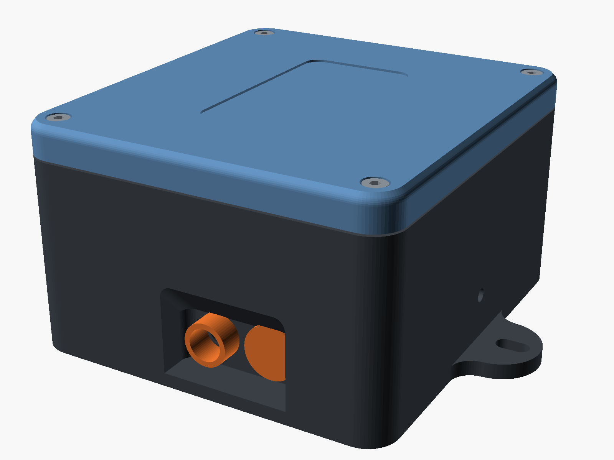
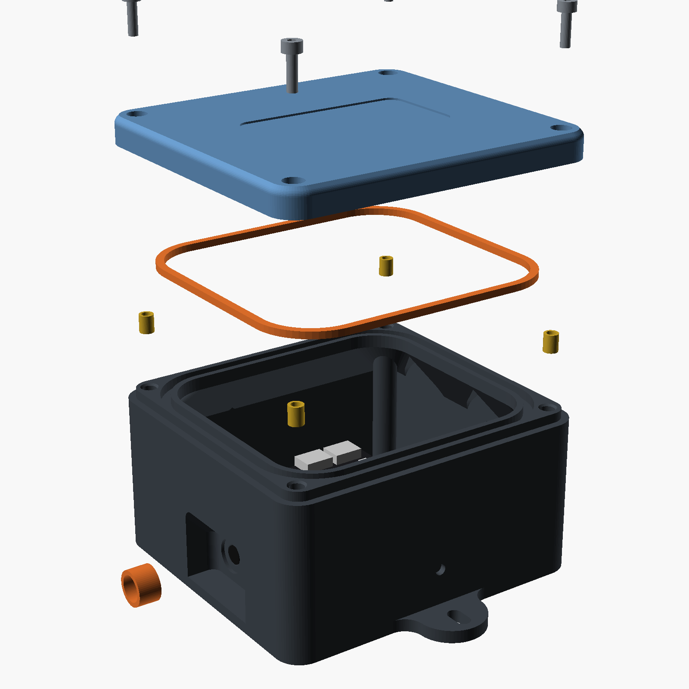
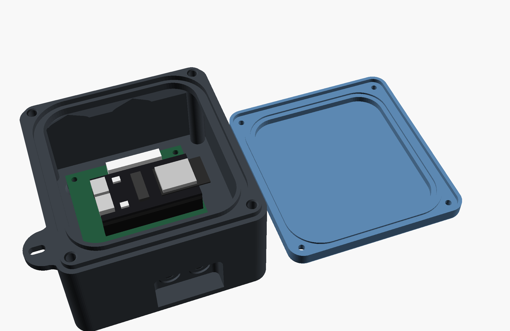
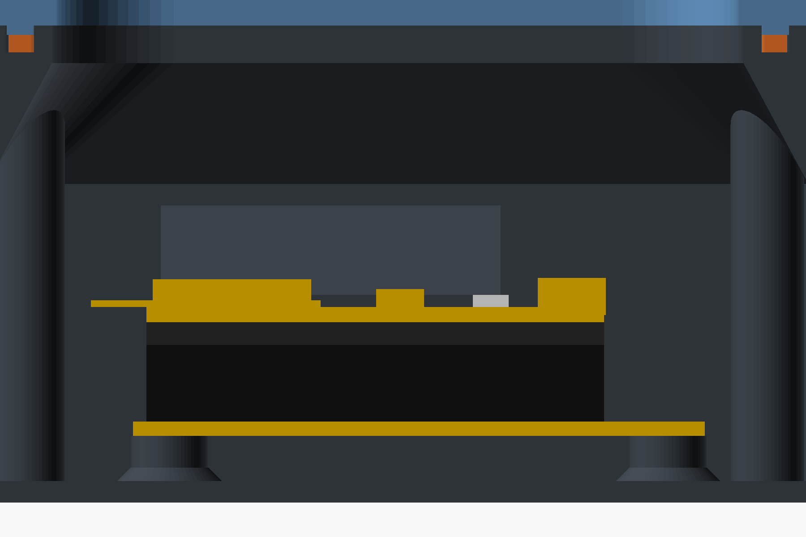

| | Freenove | LILYGO |
|---|---|---|
| Outside | 104 x 96 x 59 mm (body 53, lid 6), plus the ears | 104 x 146 x 55 mm (body 49, lid 6) |
| Board on the carrier | U1_B1/U1_B2 sockets, all 40 pins, no offset | U1_A1/U1_A2 on 30 mm stacking pins |
| Board underside over the carrier | 11.04 (socket 8.5 + male header plastic 2.54) | 30.0 |
| Height set by | the upper row of PG7 locknuts and their spot faces in the rim chamfer: body 52.9. Boards and XH plugs alone need 29.2 | the GNSS patch 7 mm from the LILYGO edge (48.5), heatsinks 47.7 |
| PG7 knockouts | 4 on the right wall next to J3A-D, staggered in two rows | 4 on the right wall, one row |
| Retention | the 40 header pins in the U1_B sockets | modem-end standoffs |
| DC jack | molded knockout in the end wall away from the PCB antenna, x 24.9, left of the USB-C plug path, see [DC jack (Freenove)](#dc-jack-freenove). `dcjack_adapter` still fits any PG7 knockout | left wall beside the port panel |
| Back magnets | 6 pockets (`body_magnets`) | 12 |

`make stl-freenove` writes `stl/freenove/` (body, both lids, label insert, gasket, `body_magnets`,
the two modifiers). Gasket boots, caps, glands and adapters are the shared files in `stl/`.
`make png-freenove` writes `png/freenove/`. `make test` checks both sets.

### Where the Freenove numbers come from

| Fact | Value | Source |
|---|---|---|
| Carrier sockets for the Freenove | U1_B2 x 32.004, U1_B1 x 57.404, 20 pins each, y 2.794 to 51.054 | `PickAndPlace.csv` (KH-2.54FH-1X20P-H8.5) |
| Pin 1 by net | U1_B1-1 VSYS (the Freenove 5V pin), U1_B1-19 RST, U1_B2-1 TXD, U1_B2-20 GND | `Netlist.tel` |
| Freenove pinout | 2 x 20: 3V3, RST, IO4 ... IO14, 5V and TX, RX, IO1 ... IO19, GND. 3V3 and TX at the antenna end | vendor pinout image |
| Board outline | 27.94 x 50.80, rows 25.4 apart, pins at 2.54 | vendor 3D model |
| Board thickness | 1.69 | vendor 3D model, check: calipers |
| Male header plastic, pin below it | 2.54, 5.6 into the 8.5 socket | vendor 3D model |
| Deepest underside part | 1.94 (SD slot) | vendor 3D model |
| ESP32-S3-WROOM-1 | 18 x 25.5 x 3.1, antenna end 6.2 past the board edge | vendor 3D model, Espressif WROOM-1 datasheet in the vendor repo |
| USB-C (two) | shells 3.25 above the board top, mouths at the board end, facing +y in the case | vendor 3D model |
| Tallest top part | 9.03, the OV3660 camera on its FPC over the module. USB-C alone 3.25 | vendor 3D model |
| EN and BOOT buttons | 3 x 4, 1.36 tall, next to the USB-C ports | vendor 3D model |

Vendor 3D model: `3D_Models/FNK0102A/3D_Shell_ESP32-S3/CB8201_OV3660.STL` in
<https://github.com/Freenove/Freenove_Media_Kit_for_ESP32-S3>, read with numpy, not copied. It carries the
same board as the FNK0085 repository <https://github.com/Freenove/Freenove_ESP32_S3_WROOM_Board>
(pinout `ESP32S3_Pinout.png`). The model's outline, 2 x 20 rows at 25.4 and pin order match the carrier's
U1_B footprint and nets exactly. The model has no licence file, so only the numbers are used.

`base-lora-carrier/docs/design.md` calls the Freenove a 19-pin subset of a 2 x 21 socket. That is the LoRa
carrier draft. Base carrier v0.2 has its own 1 x 20 sockets for it, and every pin lands.

### Placement and keep-outs

| Check (echoed and asserted on every render) | Value |
|---|---|
| Board | x 30.7 to 58.7, y 1.5 to 52.3 on the carrier, turned 180 deg like the LILYGO, underside z 20.03 |
| PCB antenna | overhangs the carrier bottom edge, y -4.7 to 2.2. 12.7 to the carrier ground below, 28.9 to the nearest screw or insert, 11.5 to the inner wall. No plastic over it but the lid |
| Free end | none: the 2 x 20 pins run the full board length. The module overhang carries the antenna and stays free |
| Lid rib | off (`fre_hold = false`, 2026-11-26). Under the 53 body it would hang 31 tall and 2.4 thin from the lid and break. The 40 header pins hold the board. `fre_hold = true` brings back the rib, 0.5 over the USB-C shells |
| USB-C with the lid off | reachable. Centre z 22.9, 22.5 mm free from the mouth to the inner wall, the rim chamfer starts at z 35.4. A right-angle plug fits, a straight plug fits if plug and strain relief are 15 mm or less (it needs the 6.7 mm insertion travel too). Check: your cable |
| EN and BOOT | reachable from the top with the lid off |

### DC jack (Freenove)

The gland wall above the vent faces the PCB antenna, so the Freenove case puts the same molded jack hole
(double-D 8.1 with flats 7.0, knockout membrane, nut spot face in the rim chamfer) in the opposite end
wall. The antenna end comes from the board model. No gland is left on that wall, so x stays where it sat
beside the old x 12 locknut: 2.5 mm off the USB-C plug path. `dcjack_fre = false` drops it, `dcjack_adapter` still fits a PG7 knockout.

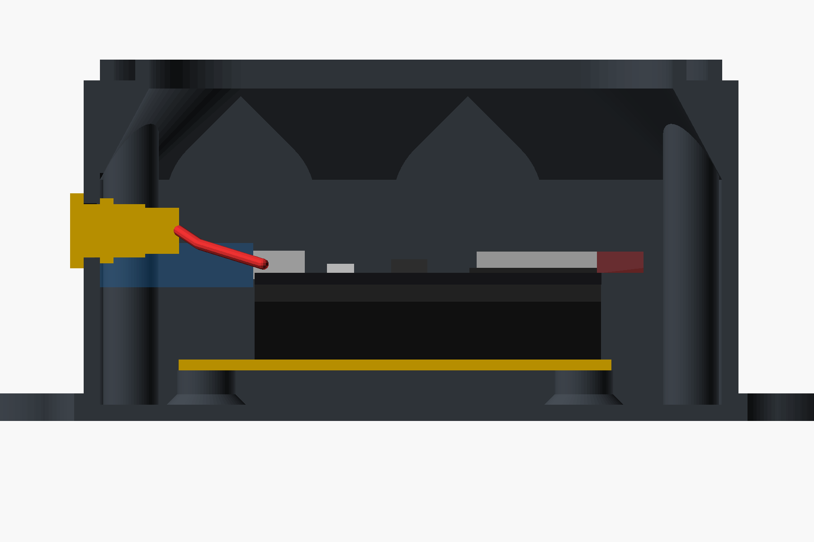
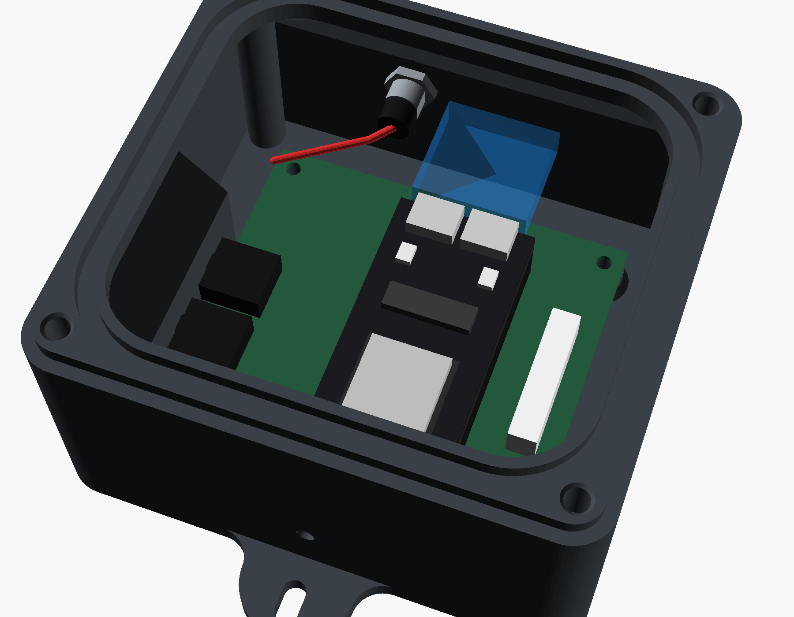

| Check (echoed and asserted on every render) | Value |
|---|---|
| Jack centre | x 24.9, z 27.9 (25.5 above the floor), end wall away from the antenna. Window x -0.4 to 26.4 |
| Body height | 53 (outside 59), set by the PG7 glands. The jack spot face needs 41.6 |
| Nut and lugs (14 behind the outer face) | 6.4 to the carrier parts, 11.1 to the Freenove, 14.9 to the PWR_IN plug and its wire bend. No PG7 locknut on that wall |
| USB-C plug path | 2.5 from the nut. Path is 12.35 x 6.5 (Type-C overmold max) from the mouths to the wall |
| Wire to PWR_IN | 24.8 mm straight, 58.2 from the antenna in plan, 8.0 from the plug path |
| Antenna to metal | 12.7, unchanged (carrier ground). The jack is 61 mm away |
| Spot face top to the rim ledge | 12.4 |

### Probe glands (Freenove)

All four PG7 knockouts sit on the right wall (x max), the wall nearest the 1-Wire connectors J3A-D at
x 68.58 (2026-11-26). The DC jack stays in the end wall. Positions are derived, the same rule
as the LILYGO case (see [Probe glands](#probe-glands)): between the corner screw columns, staggered in
two rows here because one row does not fit. The straight wall
between the columns leaves 49.9 mm for the gland centres, one row at 25 mm pitch needs 75. The upper row
locknuts get a spot face in the rim chamfer, the same teardrop pocket as the DC jack nut.

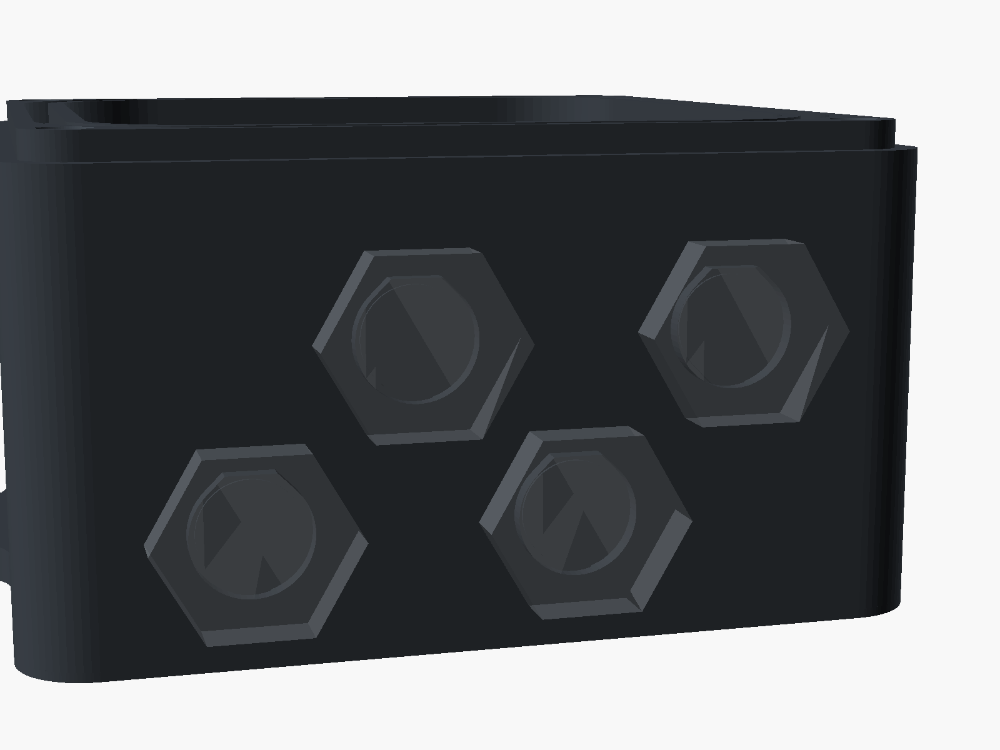
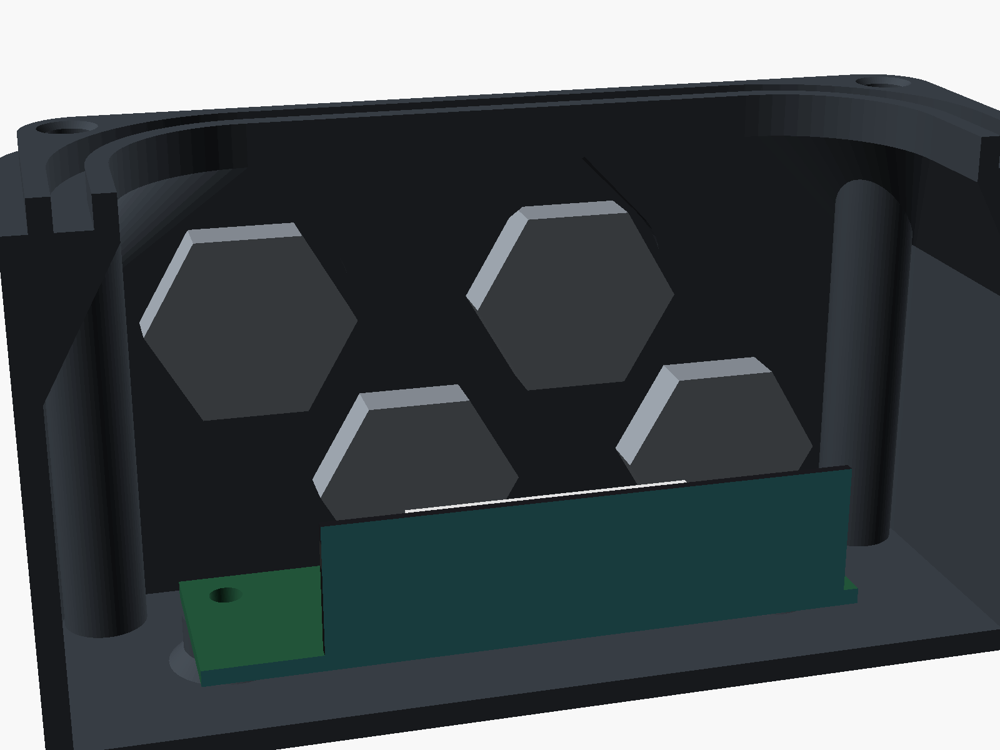

| Check (echoed and asserted on every render) | Value |
|---|---|
| Gland centres, y along the wall | 4.5, 21.1, 37.7, 54.4: pitch 16.6, centred on the wall (y 29.4), J3A-D centre is y 27.3 |
| Height above the floor | 11 and 29.7, alternating. Lower locknut 0.5 off the floor |
| Locknut gap (21 across corners) | 4.0 between neighbours, `gland_wrench` asks 4 |
| Corner screw columns | 1.0 from the spot face radius (11.0) at both ends |
| Spot faces | 2 (upper row), top 1.1 under the rim ledge |
| Body height | 53, was 44: the upper row sets it. One row would need the case about 25 mm longer instead |
| Inside | locknut inner face x 82.7, 10.9 to the XH plugs, 24 to the Freenove. Carrier standoffs and magnet pads stay below and inboard |
| Probe runs | gland 1 to 4 in y order to J3A-D in y order, no crossing in plan. 21.7, 17.1, 18.5, 24.3 mm from the locknut face to the plug tops |

### Still to measure (Freenove)

| Parameter | Default | Measure |
|---|---|---|
| `fre_pcb` | 1.69 | board thickness, calipers |
| `fre_spacer` | 2.54 | carrier top to the Freenove underside on the sockets should be 11.04, calipers |
| `fre_usb_z` | 3.25 | USB-C shell top above the board top, calipers |
| USB-C cable | | plug and strain relief length of the flashing cable, 15 mm or less for a straight plug |
| `fre_top_h` | 9.03 | only if a camera is fitted: its top above the board |

## Measured and still to measure

| Parameter | Default | Measure |
|---|---|---|
| `stack_gap` | 30.0 | carrier top to LILYGO underside on the stacking pins |
| `plug_h`, `wire_bend` | 7.0, 5.0 | XH plug height (measured) and a bend allowance above it. `car_top_h` = header 7 + plug + bend = 19 |
| `plug_d` | 8.8 | 3.5 mm plug body, calipers: ribbed, no thread. Boot bore is plug_d - 0.4 (8.4) for a light squeeze on the ribs |
| `cable_d` | 4.0 | DS18B20 probe cable diameter, calipers (PG7 clamps 3 to 6.5 mm) |
| `dcjack_thread`, `dcjack_depth`, `dcjack_flange_d` | 9, 14, 11 | DC jack thread length, depth behind the panel, front flange. Guesses. Body 7.8 with 6.8 flats and nut 11 across corners are measured. A jack 12.9 or less deep clears the carrier edge and could sit beside J1A at the jack height |
| `vent_patch_d` | 12 | adhesive ePTFE vent patch on the bottom wall |
| `ad_thread_d` | 12.2 | printed PG7 thread of the adapter. Test-fit the locknut first |
| `material`, `lid_insert`, `pcb_insert` | pla, m3_small, m3_small | `[pla, petg, abs]` and `[m3_large, m3_small]` per use (lid columns, carrier standoffs). Pick `ins_d` and `ins_wall` from one table in the scad. Pick the row for what you print and press in, then check it on the matching fine coupon |
| `ins_d` by insert and material | m3_large 4.35 in pla, petg and abs, m3_small 4.15 in pla, petg and abs | Measured: m3_large/pla, m3_large/petg, m3_small/petg. Not measured: m3_small/pla 4.15 (4.2, the insert OD, sits loose, 4.15 is about 0.05 under it, check: `insert_test_fine_small`). Placeholders, check: coupon: m3_large/abs, m3_small/abs |
| Insert sizes | m3_small M3 x 4.0 / 6 / 8 / 10 long, OD 4.2. m3_large M3 x 4 only, OD about 5.0 over the knurl | m3_small: package marking m3x4x4.2, lengths 4, 6, 8, 10. m3_large: only 4 mm long, OD almost 5 over the knurl. Hole vs OD: m3_large 4.35 in PLA is about 0.65 under the knurl OD, m3_small 4.15 is 0.05 under its 4.2. Open question: does m3_small have a much shallower knurl, or is the 4.2 its pilot? Not guessed. `ins_od` only drives the preview |
| `ins_wall` | 2.0 m3_small, 1.9 m3_large | boss wall round the lid insert hole. 2.0 fails the corner screw room assert at the m3_large 4.35 and 4.4 holes and fits at m3_small 4.15 |
| `lid_ins_len`, `pcb_ins_len` | 8, 4 | `[4, 6, 8, 10]`. Lid column pocket is `lid_ins_len` + 6.5 deep, carrier standoff pocket `pcb_ins_len` + 2. m3_large allows only 4 (assert). Max per position: lid columns 10 in both variants (pocket 40 deep available, set by the floor) but the screw sets it, M3 x 12 takes up to 8 and M3 x 16 up to 10. Carrier standoffs max 4 in both variants (a 6 mm insert needs an 8 deep pocket, the floor and standoff are 7.4 tall and 1.2 must stay under it, limit 4.2) |
| `ins_d` | 4.15 (pla, m3_small) | lid insert hole, from the table. `car_ins_d` is the carrier standoff hole, from the same table. CNC Kitchen uses straight, not tapered holes, just large enough that the tip enters, and tests 4.0 to 4.4 ([CNC Kitchen](https://www.cnckitchen.com/blog/tipps-amp-tricks-fr-gewindeeinstze-im-3d-druck-3awey)) |
| `ins_chamfer` | 0.6 | 45 deg lead-in at the mouth of every insert hole, cone from `ins_d` + 2 x this down to `ins_d` |
| `ipex_gnss` | [30, 116.55] | GNSS u.FL position on the LILYGO (a guess, next to the LTE u.FL) and the pigtail lengths. Patch 7 and flex 0.4 are measured (2026-11-26) |
| `sma_depth` | 12 | SMA bulkhead body and crimp behind the wall, calipers on the pigtail you buy |
| `heatsinks` | see scad | SIM7080G and PMU centres from the vendor pinout image, calipers still open |

## Parameters

| Parameter | Default | What it does |
|---|---|---|
| `r_v` | 8.0 | vertical edge radius |
| `r_lid` | 2.5 | lid top edge radius (last 0.7 mm runs at 45 deg so it prints face down) |
| `back_chamfer` | 1.0 | 45 deg chamfer on the back edge |
| `label_w`, `label_l`, `label_depth` | 56, 30, 0.6 | recess on the lid for a label or logo, and the `label_insert` that fills it. `label_depth = 0` removes both |
| `wall`, `floor_t`, `lid_t` | 2.4 | shell thickness, asserted 2 mm or more |
| `clear` | 4.0 | board envelope to the inner rim edge. Sized so the carrier corners pass the rounded rim ledge (asserted) |
| `lip_t`, `lip_h` | 2.0, 3.0 | lid skirt over the seam. It is the drip edge and hides the seal |
| `car_so` | 5.0 | carrier standoffs, clear of its through-hole pins |
| `groove_w`, `tpu_shore`, `g_h` | 3.2, 95, 2.2 | groove width, TPU hardness, gasket height. `tpu_shore` sets compression (95A 12 %, 90A 15 %, 85A 20 %, 82A 25 %) and the gasket width follows: the widest 0.1 step under 90 % groove fill. 95A gives 2.5 wide (0.35 per side), squeezed to 1.94. Softer TPU is a one-line change |
| `Rg` | 17 | groove corner radius. Larger than the outside corner so the insert bosses fit outside the seal |
| `m3_len` | 12 | lid screw length, asserted against the insert hole. Needs to reach through the lid insert: 12 for 4 to 8, 16 for 10 |
| `cb_d`, `cb_h` | 6.2, 3.2 | head counterbore in the lid. Its roof prints as two bridge layers (slot, then square) |
| `ins_d`, `ins_l`, `ins_hole_l` | 4.15, 8, 14.5 | body insert hole (lid columns): 8 mm M3 insert in a 4.15 hole (PLA, `m3_small`) with a 0.6 chamfer, 14.5 deep for the screw tip |
| `heatsinks`, `hs_h` | ESP32-S3, SIM7080G, PMU, 6 | heatsink footprints on the LILYGO top. The body height follows from the tallest. SIM7080G and PMU centres are read off the vendor pinout image, check with calipers |
| `gland` | `pg7` | `pg7` (12.5 hole), `m12` (12.2 hole) or `printed` (boss, TPU grommet, clamp cap) |
| `gland_side`, `gland_n`, `gland_zc`, `gland_zc_lo`, `gland_wrench` | 2, 4, 13, 11, 4 | probe glands: wall (+2 right, -2 left), count, height of one row, lower row height of two, gap between locknuts. Positions and a second row are derived, see [Probe glands](#probe-glands) |
| `knockout`, `ko_t`, `ko_ring_t`, `ko_ring_w` | true, 0.8, 0.45, 0.8 | every gland hole and the vent stay shut by a membrane on the inside face, thinned to one perimeter in a ring at the hole edge |
| `jack_port`, `port_cb_d` | true, 11 | recessed panel in the left wall in front of J1A/J2A, 11 mm boot seats |
| `vent`, `vent_d`, `vent_patch_d` | true, 3.5, 12 | knockout for an adhesive ePTFE vent, patch on the inside |
| `dcjack`, `dcjack_d`, `dcjack_flat`, `dcjack_zc` | true, 7.8, 6.8, 25.5 | DC barrel jack knockout, LILYGO on the port wall (position derived), see [DC jack](#dc-jack). Double-D hole 8.1 with flats 7.0 apart, flats vertical. `dcjack_zc` is the Freenove height |
| `dcjack_fre`, `fre_usb_plug`, `pwr_in_xy` | true, [12.35, 6.5], [4.064, 51.054] | Freenove: same jack in the end wall away from the antenna, x derived between the PG7 locknut and the USB-C plug path, see [DC jack (Freenove)](#dc-jack-freenove) |
| `ins_test_d`, `ins_test_fine`, `ins_test_fine_small`, `ins_test_pitch` | [4.0, 4.2, 4.4], [4.3, 4.35, 4.4], [4.1, 4.15, 4.2], 10 | `insert_test` and `insert_test_fine` hole sizes, spacing |
| `dcjack_nut`, `dcjack_thread`, `dcjack_depth`, `dcjack_flange_d` | [11, 2], 9, 14, 11 | jack nut across corners and thickness, thread length, depth behind the panel, flange. Asserted clear of the port panel, vent patch, gland nuts, boards and standoffs |
| `ad_*` | | `dcjack_adapter`: boss 17 across flats, 2.0 front plate, PG7 thread 12.2 x 10.4 |
| `lte_antenna` | `lid` | `lid`: the flex glued under the lid between four corner locators. `sma`: no flex, external antenna in the SMA knockout. See [Antennas](#antennas) |
| `sma_d`, `sma_cl_d`, `sma_depth` | 6.6, 11, 12 | SMA bulkhead knockout in the top wall (always cut), nut and washer clearance, body depth behind the wall (guess) |
| `lte_fpc`, `lte_seat_h` | 110 x 20 x 0.4, 2 | LTE flex length, width, thickness (0.4 or less, measured 2026-11-26), corner locator height. Position derived from the lid screws, asserted 10 mm from metal |
| `gps_patch`, `gps_xy`, `gps_metal`, `ant_gap` | 25 x 25 x 7, [10.8, 96], 7, 10 | GNSS patch under the lid in the strip no board covers, four corner ribs hold it (7 thick, measured 2026-11-26). `gps_metal` to the LILYGO edge sets the body height. Asserted inside the lid pocket and clear of metal |
| `ipex_gnss` | [30, 116.55] | GNSS u.FL position for the preview cable only, check: |
| `ear_*` | | two wall ears, filleted into the body, 4.5 mm slots |
| `mag_hole`, `mag_h`, `mag_sink`, `mag_floor` | 10.1, 2, 0.1, 1.2 | magnet pockets, see [Magnet mount](#magnet-mount) |
| `ad_mag_n`, `ad_mag_u0`, `ad_mag_v`, `ad_screw` | 6, 17, 11.5, ST4.8 x 6.5 | `ear_magnet_adapter`: pockets per adapter, their spacing, the slot screw |
| `magnets`, `mag_pos` | false, 12 in a 3 x 4 grid | next version: pockets in the case back, `body_magnets` part |
| `coupon_h` | 42 | height of the test coupon. Same M3 x 12 screw as the case |

Installed, the bottom wall (vent) points down, the gland wall and the port panel face sideways.
Water runs off the lid skirt before it reaches the seam. Glands facing sideways rely on their O-ring
and the cable seal, give each probe cable a drip loop below its gland.

### Knockouts

The four PG7 holes (12.5 mm), the vent hole and the DC jack hole are cut through the wall except for a
0.8 mm membrane flush with the inside face. With the body printed back on the bed the
membrane is a vertical wall of two 0.4 perimeters, so it prints without support and an
unpunched hole stays sealed. Round the hole edge the membrane drops to one perimeter
(0.45 mm, 0.8 mm wide) so it tears along the bore. The centre's underside runs at 45 deg.
Punch from outside with a screwdriver: the outer face and the bore stay clean for the
gland's O-ring, any flash ends up inside under the locknut. Check in the slicer that the
0.45 ring prints as one wall line (Orca: detect thin walls on). Inside there is room for the PG7
locknut (19 mm across flats, 21 across corners, 5 thick).

## Probe glands

All four PG7 knockouts sit on the right wall (x max), the wall nearest the 1-Wire connectors J3A-D at
x 68.58 (2026-11-26). The model derives them: between the corner screw columns, one row at
`gland_wrench` between locknuts placed as close to J3A-D as the columns allow, else two staggered rows
(the Freenove case). The LILYGO wall is long enough for one row.

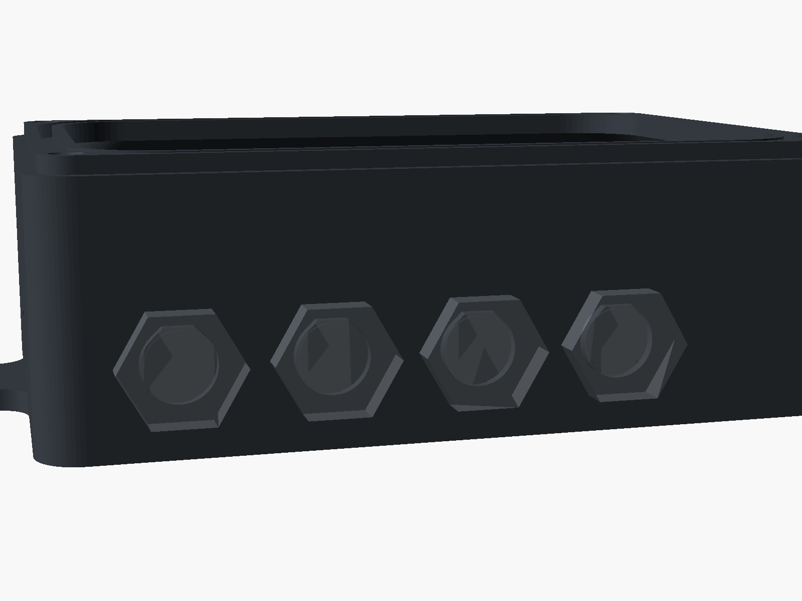
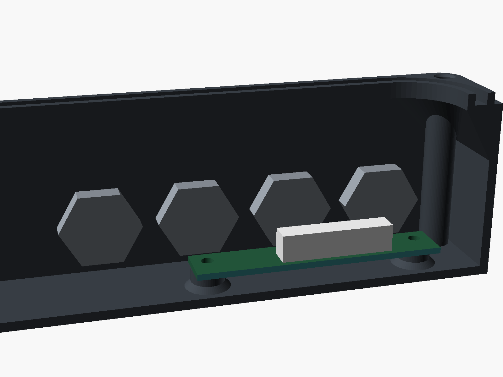

| Check (echoed and asserted on every render) | Value |
|---|---|
| Gland centres, y along the wall | 9.1, 34.1, 59.1, 84.1, pitch 25, one row 13 above the floor. The first sits at the corner column limit, J3A-D are y 17.8 to 36.8 |
| Locknut gap (21 across corners) | 4.0 between neighbours |
| Corner screw columns | window y 9.1 to 109.0, 1 mm to the column from an 11 mm spot face radius |
| Inside | locknut inner face x 82.7, 10.9 to the XH plugs, 21.5 to the LILYGO edge (x 61.2). LILYGO USB-C plug path (z 38.5 to 45) 12.6 above the locknut tops |
| Probe runs | gland 1 to 4 in y order to J3A-D in y order, no crossing in plan. 18.2, 18.9, 32.8, 49.9 mm from the locknut face to the plug tops |
| Rim | locknut tops 5.5 under the rim chamfer, no spot face needed |

## Parts and print orientation

| Part | Material | Orientation | Notes |
|---|---|---|---|
| `body` | PETG | back on the bed, open side up | no supports. Wall holes are flat-top teardrops, the port recess roof runs at 45 deg out to the wall face, insert holes open upward |
| `lid_with_label_recess` | PETG | top face on the bed (the STL is already flipped) | no supports. The recess floor is a 30 mm bridge, over the label in a two-colour print. Counterbore roofs are 1.4 mm bridge layers |
| `lid_solid` | PETG | as above | same lid, no label recess |
| `gasket` | TPU 95A | flat | 100 % infill |
| `jack_boot` | TPU 95A | seat end down | one per used jack, grips the plug body |
| `jack_cap` | TPU 95A | flange down | one per unused jack |
| `gland_grommet`, `gland_cap` | TPU, PETG | on end / flat | only for `gland = "printed"` |
| `label_insert` | PLA or PETG, other colour | flat, already in the lid's frame | fills the recess exactly. Load it with `lid_with_label_recess`, see below |
| `modifier_inserts` | none, slicer only | do not print | 4 corner insert bosses, 9.15 mm, full body height. Load as a modifier, see below |
| `modifier_carrier_mounts` | none, slicer only | do not print | 4 carrier standoffs, 9.15 mm round the 4.15 M3 insert hole |
| `dcjack_adapter` | PETG or PLA | boss face on the bed, thread up | DC jack in a PG7 knockout of an already printed case. 0.12 layers for the thread, 100 % infill. Nut slot roof is two bridge layers |
| `dcjack_adapter_gasket` | TPU 95A | flat | 17 x 12.6 x 1.5 ring under the adapter boss, outside |
| `ear_magnet_adapter` | PETG | cap face on the bed (already flipped) | two per case, 6 magnets each, see [Magnet mount](#magnet-mount) |
| `body_magnets` | PETG | as `body` | next version: `body` with 12 magnet pockets in the back |
| `coupon_body`, `coupon_lid`, `coupon_gasket` | as above | as above | one corner: groove, screw column, insert, J2A port, one carrier standoff. The glands left that corner, so no gland knockout |
| `insert_test` | PETG, as the body | flat, holes up | insert test: 30 x 13.3 x 15.7 block, holes 4.0, 4.2, 4.4 x 14.5 with the 0.6 chamfer, labels debossed on top. About 10 min, 5 g |
| `insert_test_fine` | PETG, as the body | flat, holes up | same block, holes 4.3, 4.35, 4.4, the same whatever `material` is. m3_large: 4.35 in PLA and PETG |
| `insert_test_fine_small` | PLA, as the case | flat, holes up | same block for the m3_small inserts, holes 4.1, 4.15, 4.2. Pick the hole that holds the insert, then set the m3_small row of the table |

`make test` runs `check_overhang.py` on every STL. It fails on any down-facing
surface steeper than 45 deg and on a flat ceiling no bridge can span: one with a
hole in it (the ring round the old back screw recess, which printed badly) or one
with no wall under any edge. Real bridges are listed with their span. All parts pass.

## Which lid file to print

`lid_with_label_recess.stl` and `label_insert.stl` share one coordinate system (neither is re-centred), so loaded together the label sits exactly in its recess. Label top face is flush with the lid top, label bottom is the lid's top plane at z = 0, 0.6 mm thick, one island, no overhang.

| Want | Load | Result |
|---|---|---|
| Plain lid, nothing on top | `lid_solid.stl` | flat top, no recess |
| Two-colour label | `lid_with_label_recess.stl` and `label_insert.stl`, together | label colour inlay in the lid top |
| Label as a loose part | `label_insert.stl` alone | flat 56 x 30 x 0.6 plate, glue into the recess of a `lid_with_label_recess` print |

Orca steps for the two-colour lid:

1. Add both STLs at once (select both files in the open dialog).
2. Answer Yes to "load these files as a single object with multiple parts".
3. In the object list give `label_insert` its own filament (right-click the part, change filament). The lid stays PETG.
4. Slice. Layers 1 to 3 print both parts, so the printer needs a multi-material setup. Check layer 1 in the preview: the label shape in colour two inside the lid.

A printer without multi-material prints `lid_solid` or the loose label. The recess and the label are the same size, so if the glued label is tight, scale it to 99.5 % in the slicer.

## Orca modifiers for the inserts and standoffs

Two modifier STLs share the body's coordinate system (none is re-centred), so each lands on its bosses. Heat-set inserts want solid walls round the hole.

| File | Covers | Diameter |
|---|---|---|
| `modifier_inserts.stl` | 4 corner M3 insert bosses | 9.15 mm (hole 4.15 + 2 x 2.5) |
| `modifier_carrier_mounts.stl` | 4 carrier standoffs, M3 inserts | 9.15 mm (hole 4.15 + 2 x 2.5) |

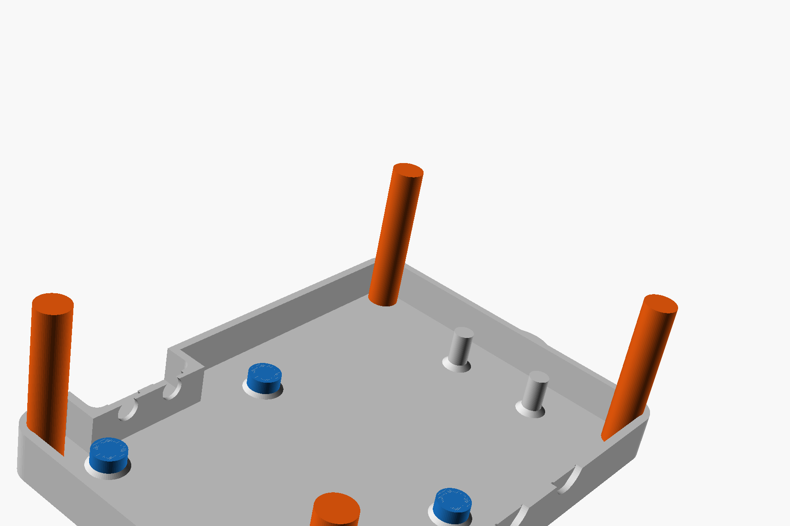

Orange is the corner bosses, blue the carrier standoffs. The body is cut at z = 14 in the picture only.

1. Load `body.stl` as an object.
2. Right-click the object, Add part, Modifier, From file. Pick the two `modifier_*.stl` files.
3. Answer Yes to keep the position. Do not move or re-centre them.
4. Select each modifier and set Strength, Wall loops to 5 or 6, or Infill density to 100 %.
5. Slice and check the preview: the insert and standoff walls are solid rings, the rest of the body is unchanged.

The LILYGO standoffs stay in the model, but their M2 screws are optional: the LILYGO rides on the carrier headers and the carrier is screwed to its standoffs. No modifier for them.

The lid label two-colour step above is separate and unchanged.

## Antennas

Both antennas glue under the lid, each between four corner locators. The LTE flex cannot sit next to
the GNSS patch (the strip left of the LILYGO is 32 wide, patch and flex need 45), and no wall is free
for it, so it goes in the right half of the lid, as far from the LILYGO as the lid screws allow. It
lies over a 5 mm strip of the LILYGO edge and over the carrier. That costs some detuning, a deliberate
choice (2026-11-26). An SMA knockout in the top wall takes an external antenna instead, without a
reprint.

| | GNSS patch | LTE flex (`lte_antenna = "lid"`, default) |
|---|---|---|
| Size | 25 x 25 x 7 (7 measured 2026-11-26) | 110 x 20 x 0.4 or less (test-fitted 2026-11-24, thickness measured 2026-11-26) |
| Where | flat under the lid in the strip left of the LILYGO (x -1.7 to 23.3, y 83.5 to 108.5, z 45.6 to 52.6), face up to the sky through 2.4 mm of lid | flat under the lid along y, x 56.0 to 76.0, y 4.0 to 114.0 |
| Over the boards | nothing | 12.0 over the LILYGO top on a 5.1 mm strip of its edge, 43 over the carrier. No heatsink under it, 4.0 over the 8 mm LILYGO top-part keep-out, 8.9 over the USB-C shell |
| Gap to metal | 7.3 to the LILYGO board edge, 14.6 to the nearest screw, 41.7 to the carrier | 10.0 to the two right lid screws and inserts (`ant_gap`, it sets the x), 32.7 to the GNSS patch |
| Mount | four corner ribs 3 tall on the lid ceiling, 0.6 clear of the patch, glued | four corner ribs 2 tall (`lte_seat_h`), 0.6 clear of the flex, glued |
| Cable | u.FL pigtail to the GNSS u.FL on the LILYGO, about 40 mm, check: connector position | pigtail from the flex end at y 114 to the LTE u.FL ANT_146, about 30 mm. Both need slack to set the lid beside the case: 100 mm or longer |

| SMA knockout (both settings, `lte_antenna = "sma"` drops the flex) | Value |
|---|---|
| Where | top wall, x 44.7 between the LILYGO modem-end standoffs, z 24.9 (22.5 above the floor) |
| Hole | 6.6 for the 1/4-36 UNS bulkhead thread (6.35), knockout membrane like the glands |
| Clearance | 11 round it on both faces for the 8 AF nut (9.2 across corners) and the lock washer. 3.9 to the boards and standoffs with a 12 mm body behind the wall (guess), 1.0 under the rim chamfer |
| Pigtail | u.FL to SMA, 15.4 from the LTE u.FL to the wall |

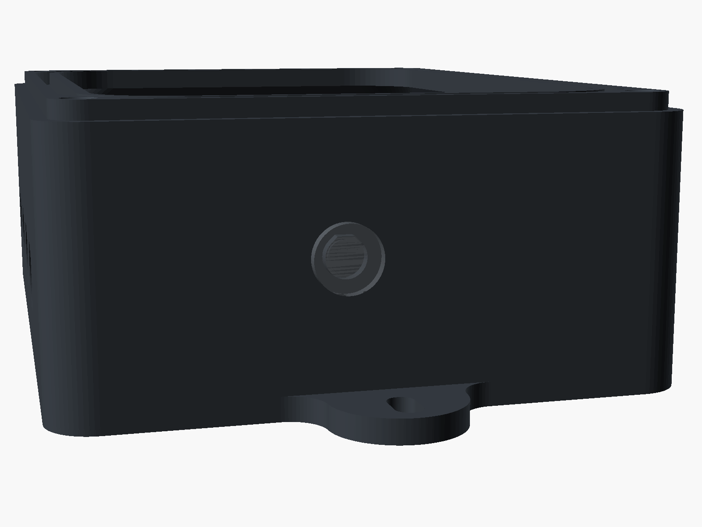

Every value is echoed and asserted on every render: both antennas inside the lid pocket with their
locators, 10 mm from screws, inserts, carrier, XH plugs, LILYGO PCB and cell, the locators clear of the
heatsinks and the LILYGO top parts, the SMA clearance off boards, standoffs, floor and rim chamfer.

RF notes:

- PLA, PETG and TPU are RF-transparent. Neither antenna may have metal paint, foil, a metal label or a heatsink above it.
- The LILYGO edge is the weak spot for both: 7.3 to the patch, 12.0 under a strip of the flex. Detuning is accepted for the flex. If LTE is weak, fit the SMA.
- The flex and the patch sit 32.7 apart, the LILYGO between them.

## DC jack

A panel-mount DC barrel jack (threaded body 7.8 mm, flats 6.8 mm apart, nut inside) sits in the left
wall beside the port panel, the closest spot to J1A/J2A that clears the carrier. At the jacks' height
its 14 mm body would run into the carrier edge (x 0), so it goes up until its nut clears the carrier
parts, and along y past the panel and the PWR_IN plug. The hole is a double-D, 8.1 round with flats
7.0 apart, flats vertical so the jack cannot turn, flat-top teardrop for printing, and a knockout
membrane like the glands. The vent stays in the bottom wall.

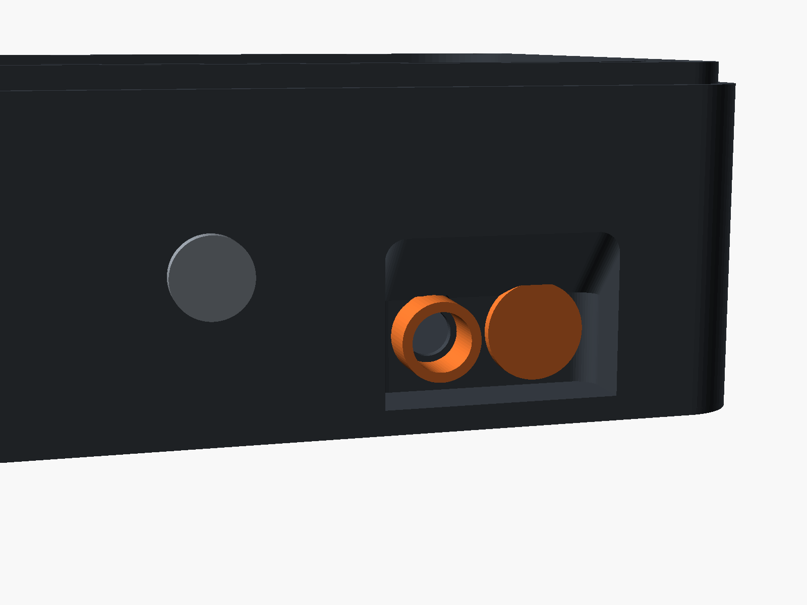
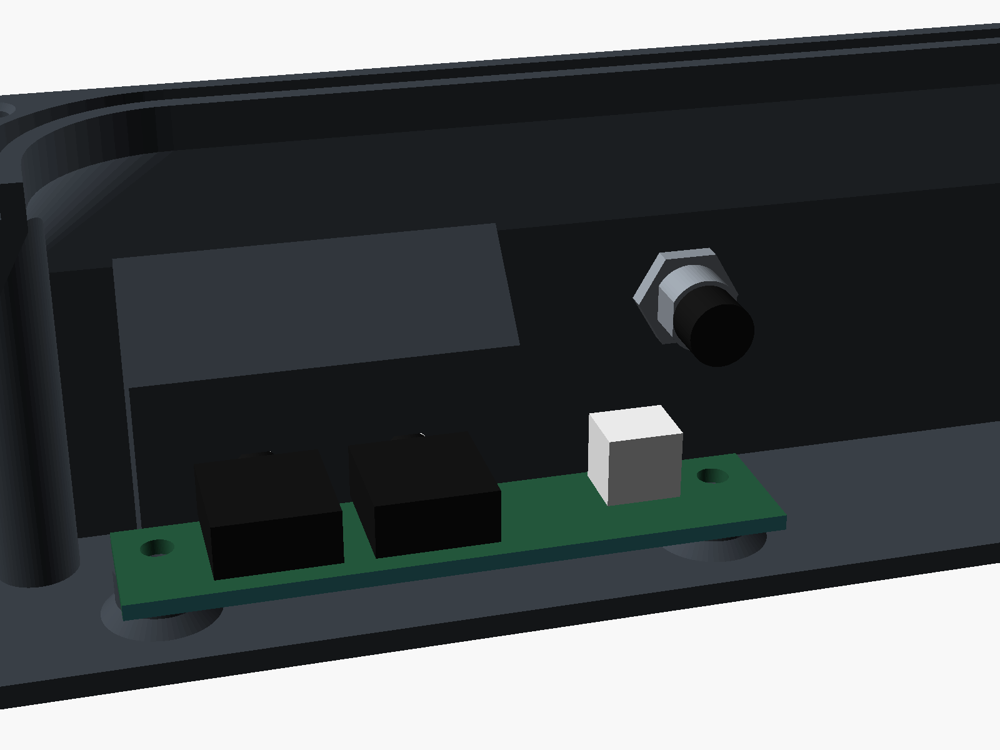

| Check (echoed and asserted on every render) | Value |
|---|---|
| Jack centre | y 61.3, z 22.5 (20.1 above the floor). J1A is y 29.5, the jack flange is 14.9 past the panel |
| Nut and lugs (14 behind the outer face, x up to 0.1) | 1.0 over the carrier parts (7 mm tall everywhere, the safe assumption), 1.2 to the PWR_IN plug and its wire bend, 30 to the LILYGO |
| Wire to PWR_IN | 11 mm straight |
| LILYGO USB-C | x 61, the other side of the case |
| Spot face top to the rim ledge | 13.8 |
| Thread past wall and nut | 4.6 of a 9 mm thread (guess, check: calipers) |

If the jack is 12.9 mm deep or less (`dcjack_depth`, check: calipers), it clears the carrier edge and can
drop to the jacks' height right beside the panel (y 47.4).

### Adapter for a printed case

`dcjack_adapter` puts the jack into a PG7 knockout of a case printed before the jack
port. A hex boss sits outside on the TPU `dcjack_adapter_gasket`, the PG7 thread runs through the
wall and takes a standard PG7 locknut inside. The jack goes in from the face through a double-D
plate (same hole as the case), its nut sits in a side slot in the boss and is spun on by finger.
A coaxial nut inside the case would need a 12.9 mm thread (plate, gasket, wall, 5 mm locknut, nut),
hence the slot.

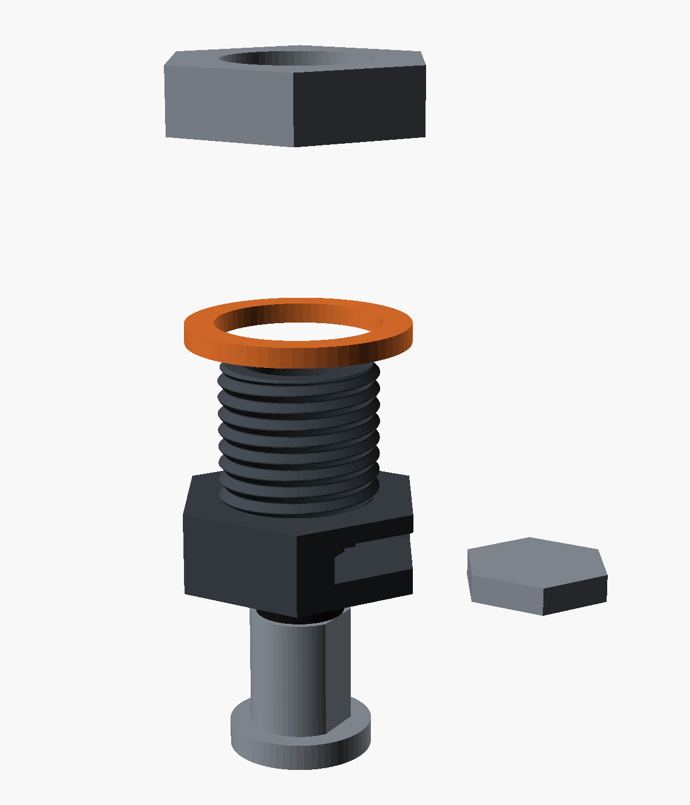

| | |
|---|---|
| Boss | 17 across flats, 6.2 tall, the 11 mm jack flange sits on it with 3 mm to spare |
| Nut slot | 11.6 wide, 2.6 tall, side walls 2.7 |
| Thread | PG7, 12.2 major (0.3 under nominal), 1.27 pitch, 42 deg flanks so it prints upright, 10.4 long |
| Jack thread used | 4.0 of 9 (plate 2.0, nut 2.0) |
| On the case | boss 4.6 from the wall corner radius and the back |

Print upright, boss face on the bed, PETG or PLA, 0.12 layers for the thread. The slot lets water
reach the jack thread like the jack face itself does, so use a knockout that faces down or sideways under a drip edge.

## Magnet mount

For sheet steel (a duct, a cabinet, a furnace panel) instead of screws through the ears. Two ways,
both with 10 x 2 mm N52 discs pressed into pockets that open to the back, so the case still lies flat
with its whole back on the sheet.

### Ear adapter for a printed case

`ear_magnet_adapter` is a shoe over one printed ear. It wraps the ear outline with 0.3 mm play, a
3 mm cap sits 0.1 above the ear top, and a flange runs beside the ear along the case wall. The
adapter is one flat block 7.1 mm tall: its back face is the case back plane, nothing sits behind
it, and the cap clearance means the flange reaches the sheet even on a slightly thick ear.

| | |
|---|---|
| Block | 94.9 x 18.4 x 7.1, 0.3 off the case wall, within the case width |
| Pockets | `ad_mag_n` = 6 per adapter (3 each side of the ear), 10.1 x 2.1, centres 17, 28.7 and 40.4 from the ear centre line, 11.5 out from the wall |
| Walls | pocket to ear cavity 1.85, to the flange edges 2.15, between pockets 1.6, 5.0 over each magnet |
| Screw | ST4.8 x 6.5 pan head self-tapping (DIN 7981) through the cap into the 4.5 mm ear slot. It cuts into the slot walls 3.4 deep and stops 0.6 above the back plane |
| Print | cap face on the bed (the STL is already flipped), pockets and ear cavity open upward, no supports, no bridges. PETG |

The screw only keeps the adapter on the ear. Nothing may sit behind the back plane, so there is
no nut: the cap and the skirt carry the load, the case cannot move toward the sheet. Asserted on
every render: pockets 1.2 or more from the ear and the flange edges, screw tip 0.5 or more above
the back, 1.2 or more over each magnet, flange no wider than the case.

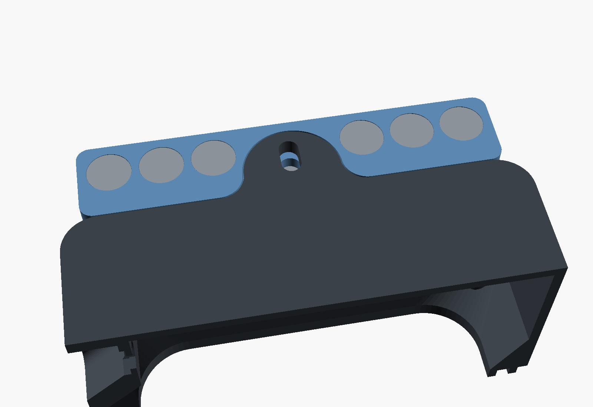

### Magnets in the case back (next version)

`magnets = true` cuts `mag_pos` pockets (count = `len(mag_pos)`, case frame) into the back. The
floor is 2.4, so each pocket gets a 13.3 mm pad inside that carries 1.2 mm over the magnet (pad top
z 3.3, 0.6 under the carrier through-hole pins). The default is 12 pockets in a 3 x 4 grid, 12.9
mm or more apart. `make stl` writes `stl/body_magnets.stl`, the plain `body.stl` is unchanged.
Pocket roofs print as 10.1 mm bridges.

Asserted per pocket: pad inside the wall with 0.5 to spare, 0.5 or more from the corner screw
columns, the carrier and LILYGO standoffs (their base flare included), clear of the jack port
panel, pad below the carrier pins, 1.6 or more between pockets, 1.2 or more over each magnet.

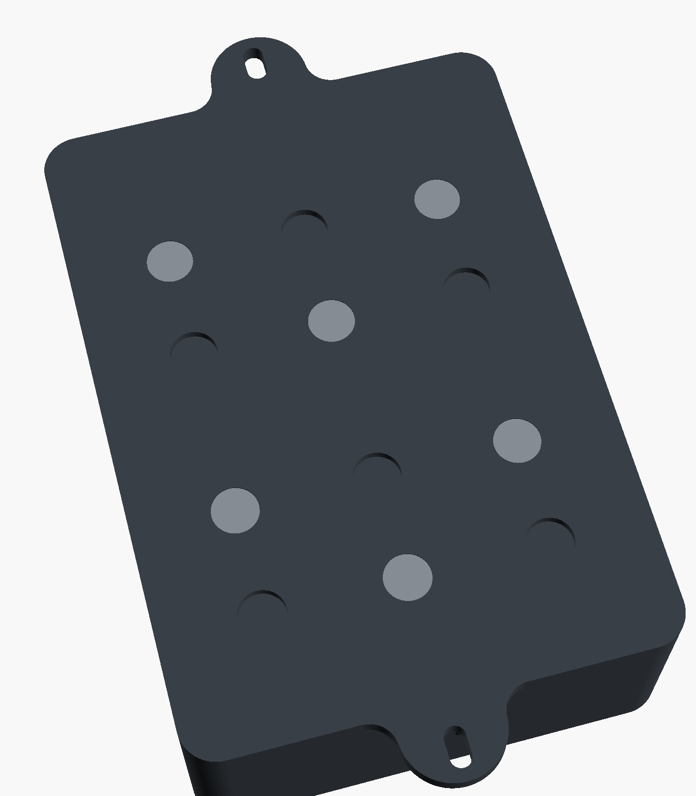

### Fit

Pockets are 10.1 for a 10.0 disc (`mag_hole`, check: calipers on the magnets and a test print)
and 2.1 deep for a 2.0 disc. Press each magnet in face down on a flat steel plate so it ends flush
with the back plane, or bottom it for 0.1 below. Glue (CA) if the press fit is loose.

### Holding force

Case mass, estimated:

| Part | Mass | Basis |
|---|---|---|
| Body | 168 g | 132 cm3 from the STL x PETG 1.27, solid (upper bound, the infill makes it lighter) |
| Lid | 71 g | 56 cm3, same |
| Gasket, boots, caps | 4 g | TPU 1.21 |
| Carrier v0.2 with parts | 30 g | FR4 76.2 x 63.5 x 1.6 is 14 g, headers, XH, jacks, ADS1115 estimated |
| LILYGO T-SIM7080G-S3 with holder | 35 g | estimate, check: scale |
| 18650 cell | 48 g | typical 45 to 50 g |
| Heatsinks, antennas, pigtails | 22 g | estimate |
| Inserts, screws | 10 g | 8 inserts, 10 screws |
| 2 PG7 glands, DC jack | 12 g | estimate |
| Cable hanging on the case | 50 g | estimate, probe and power lead |
| Case total | 450 g | |
| 2 adapters, 12 magnets | 40 g | 10 cm3 each in PETG, 1.2 g per magnet |
| On the magnets | 0.49 kg, 4.8 N | |

Per magnet:

| | Value | Source |
|---|---|---|
| Pull on a thick plate | 12.7 N (1.3 kg) | supermagnete S-10-02-N (N42, 10 x 2), measured on 20 mm steel. First4magnets rates the 10 x 2 N52 at 1.3 kg too, so no credit is taken for N52 |
| Sheet | 0.8 mm mild steel assumed (typical cabinet and duct sheet) | a thin sheet saturates. K&J Magnetics shows about 45 % of the plate pull on 24 gauge (0.6 mm) for their example disc, 50 % is assumed here for 0.8 mm. Check: pull test on the real sheet |
| Pull on the sheet | 6.4 N | 12.7 x 0.5 |
| Shear (sliding down the wall) | 1.27 N | 20 % of pull. supermagnete gives 15 to 20 %, their own 10 x 2 lists 2.48 N shear against 12.7 N pull (19.5 %) |

Wall mount, safety factor 3 in shear: 3 x 4.8 N = 14.4 N, 14.4 / 1.27 = 11.3, so **12 magnets,
6 per adapter**. That holds 15.2 N in shear (factor 3.2) and 76 N in pull (factor 16). On 2 mm or
thicker steel the shear doubles to about 2.5 N each and 6 magnets would do. An air gap costs a lot
(supermagnete: 0.5 mm halves the pull), so the backs must sit flat on clean steel, no paint blobs
or tape under the magnets.

Sources: supermagnete S-10-02-N product page and FAQ "adhesive force" (2 cm test plate, 15 to 20 %
shear), First4magnets product 19344, K&J Magnetics "Calculating Steel Thickness for Neodymium Magnets".

## Print settings

| | PETG body and lid | TPU gasket, boots, caps |
|---|---|---|
| Profile | `0.20mm PETG @K2 Plus` or `0.20mm PETG Medium` on the Ender-5 | no TPU preset yet, start from the generic TPU 95A one |
| Layer height | 0.20 (0.16 for the lid if the label edge looks rough) | 0.20 |
| Walls | 5 loops, so the 2.4 mm walls print solid | 100 % infill |
| Top / bottom | 5 / 5 | |
| Infill | 25 % gyroid (standoffs and columns print solid anyway) | |
| Speed | profile default | 20 to 25 mm/s, retraction short or off, direct drive (K2 or Ender-5) |

Read layer 1 in the slicer before printing: the body back and ear outlines, the
lid top with the label recess, the full gasket ring.

## Assembly

1. Print the three coupon parts. Press an M3 insert into the body coupon
   corner, set the gasket corner in the groove, screw the lid coupon on from the top
   with an M3 x 12. The lid face must touch the rim all round and the gasket must not
   roll out. Try a jack boot in the J2A seat and an M3 insert in the standoff.
2. Print body, lid, gasket, boots and caps.
3. Heat-set four 8 mm M3 inserts into the body corners and four M3 inserts into
   the carrier standoffs. Stick the heatsinks on the LILYGO.
4. Carrier on its standoffs, jacks against the port panel, four M3 x 6.
5. LILYGO with the cell in onto the carrier headers, two M2 x 6 self-tapping
   screws through its modem-end holes into the tall standoffs.
6. Punch the knockouts you need (and the vent). PG7 glands in the right wall, locknut
   inside. Probe cables to J3A to J3D (XH) in order, no crossing.
   USB power instead: run the cable through a spare gland and use a right-angle
   USB-C plug, the port sits 17 mm from the wall.
7. Jack boots on the CT clamp plugs, pressed into the seats. Caps in unused seats.
8. Stick the ePTFE vent patch over the vent hole on the inside. DC jack: punch its knockout
   in the port wall, jack in from outside, nut inside, wire to PWR_IN.
9. GNSS patch and LTE flex onto the lid ceiling between their corner ribs, glued, pigtails
   to the two u.FL connectors with slack to set the lid beside the case. External LTE
   instead: punch the SMA knockout in the top wall, bulkhead, u.FL to SMA pigtail.
10. Gasket into the groove, lid on, four M3 x 12 from the top.
11. Hang the case with two screws through the ears. On sheet steel: an `ear_magnet_adapter` on each ear
    with an ST4.8 x 6.5, 6 magnets in each, see [Magnet mount](#magnet-mount).

## Files

| File | What |
|---|---|
| `node-case.scad` | the model |
| `Makefile` | `make stl`, `make png`, `make test`. Bare `make` lists targets |
| `check_overhang.py` | overhang and bridge report on an STL |
| `stl/` | every part in print orientation |
| `png/` | closed, exploded, antennas inside, gland wall, DC jack adapter, magnet mount, coupon, insert test and section previews |
| `stl/freenove/`, `png/freenove/` | the Freenove variant parts and previews |
